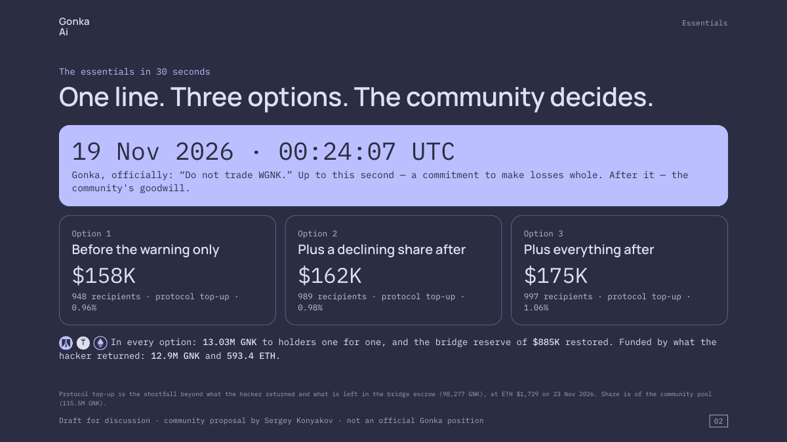
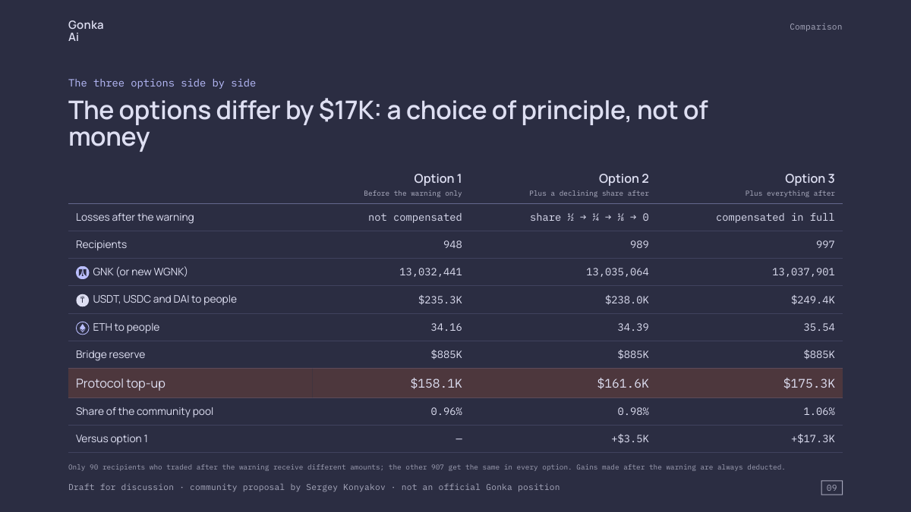
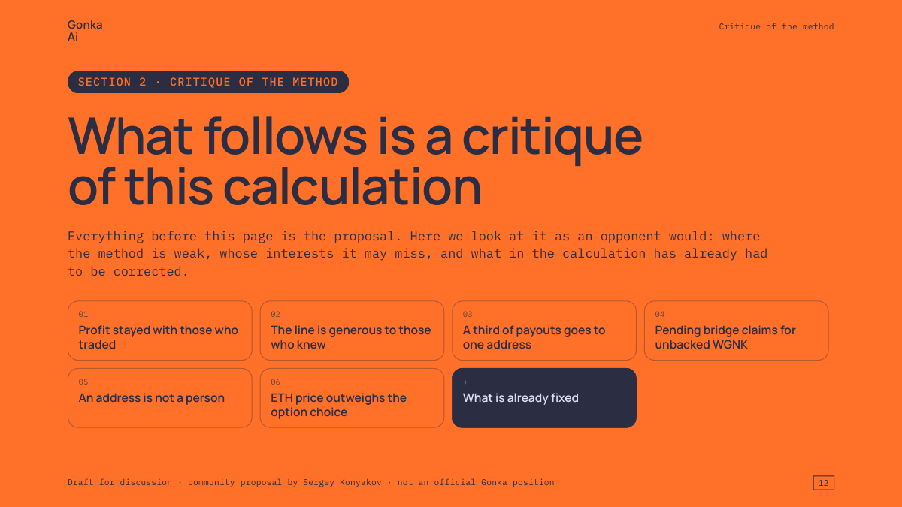

**English** | [Русский](README.ru.md)

> [!IMPORTANT]
> **Draft for community discussion — not an official position of Gonka or its Core Team.** Published by Sergey Konyakov
> ([@Konyakoff](https://github.com/Konyakoff)), a community member. The research was done with Claude Code (Fable 5.2); the
> author has not yet independently verified every address and amount. Community members and the Core Team are asked to
> re-check the logic of the calculation and the listed addresses and amounts. A shared position on compensation is to be
> reached through discussion.

# WGNK bridge hack (18 Nov 2026): three compensation options — open data for community review

On 18 November 2026 an attacker drained the Gonka ↔ Ethereum bridge reserve and minted 22,000,000 unbacked WGNK, then
returned 593.435 ETH and 12,900,401 GNK. This repository is a community member's proposal for how to make people
whole, with everything needed to check it: the method, the raw on-chain data, the calculation code, a per-address register
under three options, a critique of the method itself, and three independent reviews.

**Nothing here is decided.** The purpose is to let anyone — with or without an AI assistant — verify the logic, the
addresses and the amounts, and to reach a shared position in the discussion: https://github.com/gonka-ai/gonka/discussions/2306

## The proposal in one minute

1. **What was yours before the hack is yours.** WGNK held at the last block before the unbacked mint is honoured one for one
   in native GNK (or new WGNK).
2. **Lost money is returned in the same currency** — USDT for USDT, USDC for USDC, ETH for ETH, net of what was received.
3. **Payouts let nobody profit.** Gains are deducted; WGNK bought after the hack is voided; the attacker gets nothing.
4. **One dividing line:** the project's official warning “Do not trade WGNK”, 19 Nov 2026 00:24:07 UTC. Losses on trades
   before it are a commitment; for trades after it the community chooses one of three options.

| Option | Recipients | GNK | USDT | USDC | ETH | Protocol top-up | Share of community pool |
|---|---:|---:|---:|---:|---:|---:|---:|
| **1** — before the warning only | 948 | 13,032,441 | 213,395.34 | 21,880.08 | 34.1599 | $158,074 | 0.96% |
| **2** — plus a declining share after (½ → ¼ → ⅛ → 0 within a day) | 989 | 13,035,064 | 215,650.17 | 22,345.27 | 34.3856 | $161,563 | 0.98% |
| **3** — plus everything after (until the data freeze) | 997 | 13,037,901 | 225,171.55 | 24,192.27 | 35.5408 | $175,340 | 1.06% |

In every option the bridge reserve (884,150.87 USDT and 647.74 USDC) is restored, and 27 senders of GNK → WGNK
bridge requests that were never minted get 1,509.70 GNK back. “Protocol top-up” is what is missing beyond the attacker's
return and the GNK left in the bridge escrow, at ETH = $1,729.15 on 23 Nov 2026. Data is frozen at 23 Nov 2026 04:30 UTC
(Ethereum block 26,475,449).

<p>



</p>

**Slides** — a visual summary for a first read; the source of truth is the data, the method and the code in this repository:
[proposal (EN)](presentations/Gonka_Compensation_3_Options_EN.pdf) ·
[предложение (RU)](presentations/Gonka_Compensation_3_Options_RU.pdf) ·
[critique of the method (EN)](presentations/Gonka_Compensation_Critique_EN.pdf) ·
[критика метода (RU)](presentations/Gonka_Compensation_Critique_RU.pdf) ·
[register as PDF (EN)](presentations/Gonka_Compensation_Register_3_Options_EN.pdf) ·
[реестр PDF (RU)](presentations/Gonka_Compensation_Register_3_Options_RU.pdf)

## Find your address

Open [`registers/register.csv`](registers/register.csv) — GitHub shows it as a searchable table — and type your Ethereum
address into the search box. Each line is one payee address with the payout under options 1, 2 and 3 and the Gonka address
of the same key (where native GNK would go by default). If you sent GNK into the bridge and never received WGNK, look in
[`registers/bridge_requests_in_flight.csv`](registers/bridge_requests_in_flight.csv).

Not there, or the amount looks wrong? [Open an issue](../../issues/new/choose) with your address and the transactions you
think were missed. Nothing is final; an objection window before any payout is part of the proposal.

## What you are asked to check

| What | Where |
|---|---|
| The logic: the line, the formula, the three options | [`PROPOSAL.md`](PROPOSAL.md), [`METHODOLOGY.md`](METHODOLOGY.md) |
| The addresses and amounts | [`registers/`](registers/) |
| Where the method is weak and whose interests it may miss | [`CRITIQUE.md`](CRITIQUE.md) — read this first if you are looking for what could be wrong |
| That the register follows from the raw data | [`verify/`](verify/) — one command, no network, no API keys |
| What three independent reviewers found | [`reviews/`](reviews/) |

## Verify it yourself

```bash
pip install -r verify/requirements.txt      # pandas, pyarrow, openpyxl
python verify/run.py                        # recomputes the register from data/raw and compares; expected: 0 differences
sha256sum -c SHA256SUMS                     # every file matches its checksum
```

Working with an AI assistant? Point it at [`AGENTS.md`](AGENTS.md): it explains the layout, the units and gives ready-made
review tasks. Table schemas are in [`datapackage.json`](datapackage.json), column meanings in
[`DATA_DICTIONARY.md`](DATA_DICTIONARY.md).

## Repository map

| Path | Content |
|---|---|
| [`PROPOSAL.md`](PROPOSAL.md) | the proposal in words (same content as the slides) |
| [`METHODOLOGY.md`](METHODOLOGY.md) | windows, formula, options, liquidity positions, checks, limitations |
| [`CRITIQUE.md`](CRITIQUE.md) | self-audit: weak points, errors corrected before publication, open questions |
| [`registers/`](registers/) | `register.csv` (payee → payouts), `register_detailed.csv`, the same as XLSX, bridge requests in flight, bridge reserve holders, attacker addresses, parameters and totals |
| [`data/`](data/) | raw on-chain data exactly as the calculation reads it (Ethereum, Gonka) and the timeline of publications |
| [`model/`](model/) | computed tables: per-transaction deltas with windows, liquidity positions, owners, payees, summary, checks, critique figures |
| [`verify/`](verify/) | recomputation of the register from `data/raw` |
| [`code/`](code/) | the calculation code (runs with pandas only) and, for reference, the data collector |
| [`reviews/`](reviews/) | three independent reviews, unedited |
| [`legal/`](legal/) | case-law dossier on why the official warning is the dividing line |
| [`presentations/`](presentations/) | slides and the register as PDF, in English and Russian |

## How to check that nothing was changed

This repository belongs to the author, so do not trust it — trust the fingerprint recorded outside it. The discussion thread
quotes the commit hash and the SHA-256 of the release archive of the published version (tag `v0.1-draft`), and links point
to that exact commit.

```bash
git rev-parse v0.1-draft                    # must equal the commit hash quoted in the discussion
sha256sum -c SHA256SUMS                     # must report OK for every file
sha256sum gonka-wgnk-bridge-compensation-v0.1-draft.zip   # must equal the SHA-256 quoted in the discussion
```

Published content is never rewritten. Any correction is a new commit and a new tag, listed in
[`CHANGELOG.md`](CHANGELOG.md) and announced in the discussion with its new fingerprint; GitHub shows the exact difference
between two tags. An independent snapshot of the repository is kept by Software Heritage (identifier in the discussion and
in the changelog).

## Discussion and objections

- **Method, the dividing line, which option** — in the discussion thread: https://github.com/gonka-ai/gonka/discussions/2306
- **“My address is missing / my amount is wrong”** — [open an issue](../../issues/new/choose) here.
- Any payout from the community pool is decided only by on-chain governance; this repository decides nothing.

## Author, status, licence

Prepared by Sergey Konyakov ([@Konyakoff](https://github.com/Konyakoff)), a Gonka community member acting in a personal
capacity — not a member of the Core Team and not speaking for it. The research and the calculation were done with Claude
Code (Fable 5.2); the address ownership was not established and the author has not independently verified every address
and amount. The legal dossier is not legal advice.

Code: MIT ([`LICENSE`](LICENSE)). Data and texts: CC BY 4.0 ([`LICENSE-DATA`](LICENSE-DATA)).
