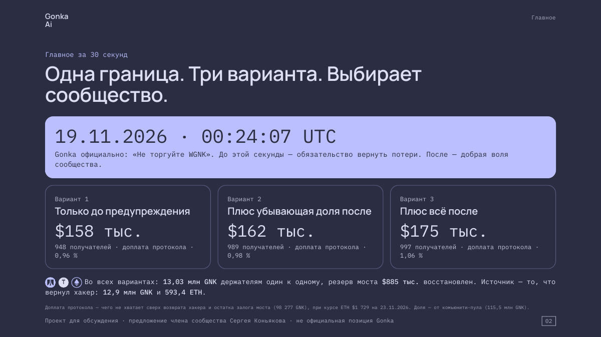
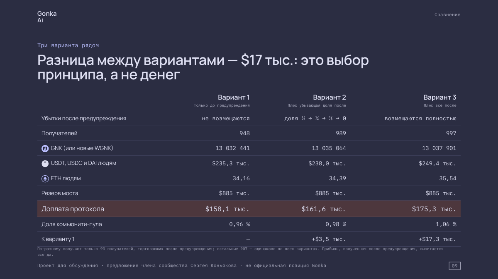
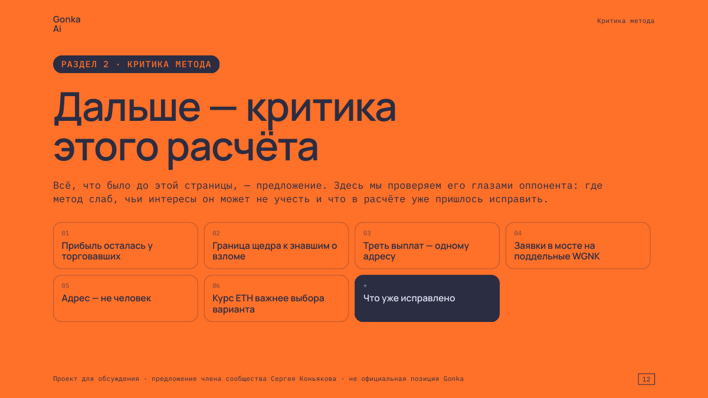

[English](README.md) | **Русский**

> [!IMPORTANT]
> **Проект для обсуждения — не официальная позиция Gonka и её Core Team.** Опубликовал Сергей Коньяков
> ([@Konyakoff](https://github.com/Konyakoff)), член сообщества. Исследование сделано с помощью Claude Code (Fable 5.2);
> автор ещё не проверил самостоятельно каждый адрес и каждую сумму. Просим членов сообщества и Core Team перепроверить
> логику расчёта и перечисленные адреса с суммами. К общему мнению о компенсациях нужно прийти в ходе обсуждения.

_Это перевод. При любом расхождении верна английская версия — [README.md](README.md)._

# Взлом моста WGNK (18.11.2026): три варианта компенсаций — открытые данные для проверки сообществом

18 ноября 2026 года атакующий вывел резерв моста Gonka ↔ Ethereum и выпустил 22,000,000 необеспеченных WGNK, а затем
вернул 593.435 ETH и 12,900,401 GNK. Этот репозиторий — предложение члена сообщества о том, как вернуть
людям их потери, и всё, что нужно для его проверки: методика, сырые данные блокчейнов, код расчёта, реестр по адресам в трёх
вариантах, критика самого метода и три независимые проверки.

**Здесь ничего не решено.** Цель — дать каждому, с ИИ-помощником или без, проверить логику, адреса и суммы и прийти
к общей позиции в обсуждении: https://github.com/gonka-ai/gonka/discussions/2306

## Предложение за минуту

1. **Что было твоим до взлома — твоё.** WGNK на последнем блоке перед необеспеченным выпуском засчитываются один к одному
   нативными GNK (или новыми WGNK).
2. **Потерянные деньги возвращаются той же валютой** — USDT за USDT, USDC за USDC, ETH за ETH, за вычетом полученного.
3. **На выплатах никто не зарабатывает.** Прибыль вычитается; WGNK, купленные после взлома, аннулируются; атакующий не
   получает ничего.
4. **Одна граница:** официальное предупреждение проекта «Do not trade WGNK», 19.11.2026 00:24:07 UTC. Потери по сделкам
   до него — обязательство; по сделкам после него сообщество выбирает один из трёх вариантов.

| Вариант | Получателей | GNK | USDT | USDC | ETH | Доплата протокола | Доля комьюнити-пула |
|---|---:|---:|---:|---:|---:|---:|---:|
| **1** — только до предупреждения | 948 | 13,032,441 | 213,395.34 | 21,880.08 | 34.1599 | $158,074 | 0.96% |
| **2** — плюс убывающая доля после (½ → ¼ → ⅛ → 0 за сутки) | 989 | 13,035,064 | 215,650.17 | 22,345.27 | 34.3856 | $161,563 | 0.98% |
| **3** — плюс всё после (до заморозки данных) | 997 | 13,037,901 | 225,171.55 | 24,192.27 | 35.5408 | $175,340 | 1.06% |

Во всех вариантах восстанавливается резерв моста (884,150.87 USDT и 647.74 USDC), а 27 отправителей заявок на
перевод GNK в WGNK, по которым WGNK так и не выпущен, получают назад 1,509.70 GNK. «Доплата протокола» — то, чего не
хватает сверх возврата атакующего и остатка GNK в залоге моста, при курсе ETH $1,729.15 на 23.11.2026. Данные заморожены
23.11.2026 в 04:30 UTC (блок Ethereum 26,475,449). Числа в таблице записаны в английском формате (запятая — разделитель
тысяч, точка — десятичный знак), чтобы совпадать с файлами данных.

<p>



</p>

**Презентации** — наглядное изложение для первого знакомства; источник истины — данные, методика и код в этом репозитории:
[предложение (RU)](presentations/Gonka_Compensation_3_Options_RU.pdf) ·
[proposal (EN)](presentations/Gonka_Compensation_3_Options_EN.pdf) ·
[критика метода (RU)](presentations/Gonka_Compensation_Critique_RU.pdf) ·
[critique of the method (EN)](presentations/Gonka_Compensation_Critique_EN.pdf) ·
[реестр PDF (RU)](presentations/Gonka_Compensation_Register_3_Options_RU.pdf) ·
[register as PDF (EN)](presentations/Gonka_Compensation_Register_3_Options_EN.pdf)

## Найдите свой адрес

Откройте [`registers/register.csv`](registers/register.csv) — GitHub показывает его таблицей с поиском — и введите свой
Ethereum-адрес в строку поиска. Строка — один адрес-получатель: выплата по вариантам 1, 2 и 3 и Gonka-адрес того же ключа
(куда по умолчанию придут нативные GNK). Если вы отправляли GNK в мост и не получили WGNK, смотрите
[`registers/bridge_requests_in_flight.csv`](registers/bridge_requests_in_flight.csv).

Адреса нет или сумма выглядит неверной? [Откройте issue](../../issues/new/choose) с адресом и транзакциями, которые, по
вашему мнению, не учтены. Ничто не окончательно: окно возражений до любых выплат — часть предложения.

## Что просим проверить

| Что | Где |
|---|---|
| Логику: границу, формулу, три варианта | [`PROPOSAL.ru.md`](PROPOSAL.ru.md), [`METHODOLOGY.ru.md`](METHODOLOGY.ru.md) |
| Адреса и суммы | [`registers/`](registers/) |
| Где метод слаб и чьи интересы он может не учесть | [`CRITIQUE.ru.md`](CRITIQUE.ru.md) — начните отсюда, если ищете, что может быть неверно |
| Что реестр следует из сырых данных | [`verify/`](verify/) — одна команда, без сети и без ключей |
| Что нашли три независимых проверяющих | [`reviews/`](reviews/) |

## Проверьте сами

```bash
pip install -r verify/requirements.txt      # pandas, pyarrow, openpyxl
python verify/run.py                        # пересчитывает реестр из data/raw и сравнивает; ожидается 0 расхождений
sha256sum -c SHA256SUMS                     # каждый файл совпадает со своей контрольной суммой
```

Работаете с ИИ-помощником? Дайте ему [`AGENTS.md`](AGENTS.md): там устройство репозитория, единицы измерения и готовые
задания для проверки. Схемы таблиц — в [`datapackage.json`](datapackage.json), смысл столбцов — в
[`DATA_DICTIONARY.md`](DATA_DICTIONARY.md) (оба файла на английском).

## Карта репозитория

| Путь | Содержимое |
|---|---|
| [`PROPOSAL.ru.md`](PROPOSAL.ru.md) | предложение текстом (то же, что в презентации) |
| [`METHODOLOGY.ru.md`](METHODOLOGY.ru.md) | окна, формула, варианты, позиции ликвидности, сверки, ограничения |
| [`CRITIQUE.ru.md`](CRITIQUE.ru.md) | самопроверка: слабые места, ошибки, исправленные до публикации, открытые вопросы |
| [`registers/`](registers/) | `register.csv` (получатель → выплаты), `register_detailed.csv`, то же в XLSX, заявки «в пути», держатели резерва моста, адреса атакующего, параметры и итоги |
| [`data/`](data/) | сырые данные блокчейнов в том виде, в каком их читает расчёт (Ethereum, Gonka), и хронология публикаций |
| [`model/`](model/) | расчётные таблицы: изменения по транзакциям с окнами, позиции ликвидности, владельцы, получатели, свод, сверки, цифры критики |
| [`verify/`](verify/) | пересчёт реестра из `data/raw` |
| [`code/`](code/) | код расчёта (запускается с одним pandas) и, для справки, сборщик данных |
| [`reviews/`](reviews/) | три независимые проверки, без правок |
| [`legal/`](legal/) | досье по судебной практике: почему граница — официальное предупреждение |
| [`presentations/`](presentations/) | презентации и реестр в PDF на английском и русском |

## Как убедиться, что ничего не подменено

Репозиторий принадлежит автору, поэтому доверять нужно не ему, а отпечатку, записанному вне его. В ветке обсуждения указаны
хэш коммита и SHA-256 архива выпуска опубликованной версии (метка `v0.1-draft`), а ссылки ведут на этот конкретный коммит.

```bash
git rev-parse v0.1-draft                    # должен совпасть с хэшем коммита из обсуждения
sha256sum -c SHA256SUMS                     # должен сообщить OK по каждому файлу
sha256sum gonka-wgnk-bridge-compensation-v0.1-draft.zip   # должен совпасть с SHA-256 из обсуждения
```

Опубликованное не переписывается. Любая правка — новый коммит и новая метка; она записывается в
[`CHANGELOG.md`](CHANGELOG.md) и объявляется в обсуждении с новым отпечатком; точную разницу между двумя метками показывает
GitHub. Независимый снимок репозитория хранит Software Heritage (идентификатор — в обсуждении и в журнале изменений).

## Обсуждение и возражения

- **Методика, граница, выбор варианта** — в ветке обсуждения: https://github.com/gonka-ai/gonka/discussions/2306
- **«Моего адреса нет / сумма неверна»** — [откройте issue](../../issues/new/choose) в этом репозитории.
- Любая выплата из комьюнити-пула решается только голосованием в сети; этот репозиторий ничего не решает.

## Автор, статус, лицензия

Подготовил Сергей Коньяков ([@Konyakoff](https://github.com/Konyakoff)), член сообщества Gonka, действующий как частное лицо —
не член Core Team и не говорит от её имени. Исследование и расчёт сделаны с помощью Claude Code (Fable 5.2); принадлежность
адресов не устанавливалась, и автор ещё не проверил самостоятельно каждый адрес и каждую сумму. Правовое досье — не
юридическое заключение.

Код — MIT ([`LICENSE`](LICENSE)). Данные и тексты — CC BY 4.0 ([`LICENSE-DATA`](LICENSE-DATA)).
